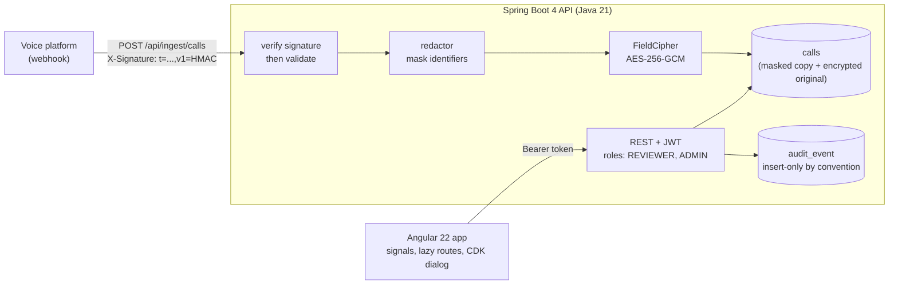
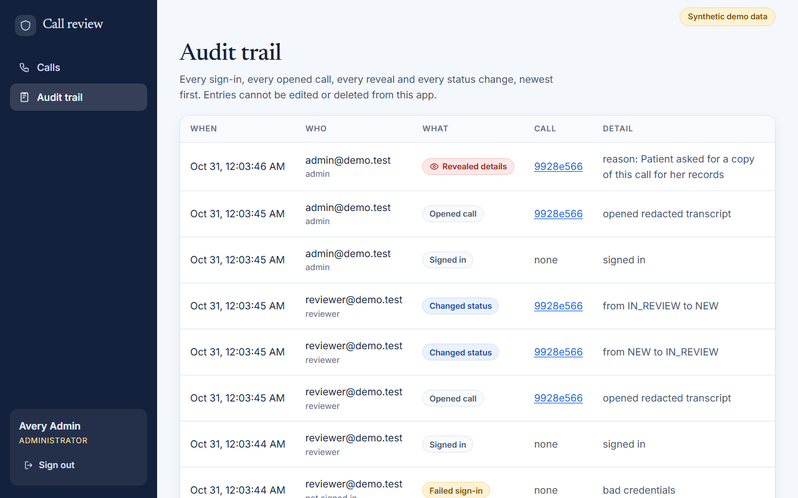

# clinic-call-console

[](https://github.com/Exalt24/clinic-call-console/actions/workflows/ci.yml)

Voice-agent call review console: personal details masked by default, revealed only with a reason, every access audited.

One Angular client talks to two interchangeable APIs for the same contract: Spring Boot, or NestJS on PostgreSQL.

**Proof:** from a fresh clone on 2026-10-17, 72 Java tests and 126 Angular tests pass. `scripts/mutation_check.py` broke 28 guards one at a time. Every one was caught by a real test failure (the reveal no longer admin-only, the audit row not written, the signature not checked, and 25 more). The NestJS API adds 137 tests against a real PostgreSQL, plus its own mutation check. That check broke 41 guards one at a time. It caught all 41 ([`docs/test-runs/`](docs/test-runs/)). CI runs the Java, Angular and NestJS suites. Both mutation checks are run by hand.


*A reviewer sees masked calls and cannot reveal anything. An administrator must give a reason to reveal. Every sign-in, view and reveal lands in the audit trail. Full-quality clip: [`docs/demo.mp4`](docs/demo.mp4).*

A review console for the calls a **voice assistant** takes. The calls are the interesting part. They are full of personal details.
The people reviewing them should see as little of it as their job allows.

- **Masked by default.** Names, phone numbers, birth dates, emails, record and insurance numbers and addresses are masked on arrival.
  Every screen shows only the masked copy.
- **Reveal on purpose.** Only an administrator can reveal a call.
  They must give a reason. The reveal and the reason are written to the audit
  trail in the same database transaction.
  The revealed text hides itself again after 60 seconds.
- **Everything is on the record.** An admin-only audit trail lists sign-ins, opened calls, status changes, reveals and incoming calls.
  Failed sign-ins are listed too, until an account locks.
  Attempts during a lockout are refused before they are recorded.

> **Built and tested on seeded sample calls.** It shows sensitive-data handling: least privilege,
> auditability, minimum necessary access, no personal details in logs. Limits are listed [below](#limits) and in
> [`docs/DECISIONS.md`](docs/DECISIONS.md).

**Live demo:** [clinic-call-console.vercel.app](https://clinic-call-console.vercel.app) (API: [clinic-call-console-api.onrender.com](https://clinic-call-console-api.onrender.com/actuator/health)). The API is on a free host that sleeps when idle, so a first request can take a minute. The hosted link shows the sign-in page. The recording above is the real run, and [Run it](#run-it) starts the whole stack locally.
Demo accounts (public on purpose, the data is seeded sample data): `reviewer@demo.test` / `reviewer-demo-pass` and `admin@demo.test` / `admin-demo-pass`.

## How it fits together



## What is built

The sensitive columns are encrypted with AES-256-GCM. The audit row is written in the same transaction as the reveal. The ingest webhook is HMAC-signed, with a replay window and idempotency. The Angular app is keyboard operable, with live regions for status changes and 44 px touch targets. The design decisions and what each one costs are in [`docs/DECISIONS.md`](docs/DECISIONS.md).

## How it is tested

| Layer | What | Count |
|---|---|---|
| Java unit and integration | redaction rules, encryption, webhook signature, lockout, and the whole API called with real tokens (wrong role, no token, forged token, expired token, missing reason, bad signature, replay) | 72 |
| Angular unit | guards, interceptors, services, every page, the reveal dialog, the route resolver | 126 |
| Browser end to end | a real Chromium walks login, filtering, masked reading, the reveal dialog, the audit trail and the phone layout at 390 px | 39 checks (not re-run on 2026-10-17) |
| **Mutation check** | `scripts/mutation_check.py` breaks one guard at a time (reveal no longer admin-only, audit not written, signature not checked, token sent to any origin, ...) and requires a genuine test failure each time | 28 of 28 caught |

The mutation check found two weak tests while this was being built. One was a cache-header assertion that Spring Security's default satisfied on its
own. The other was a mutant that did not change behaviour. An end-to-end run also found a form that submitted natively and reloaded the page. Each is now
pinned by a test.

```
cd api && ./mvnw test                      # 72 tests, no Docker needed
cd web && npx ng test --watch=false        # 126 tests (Vitest)
python scripts/mutation_check.py           # breaks 28 guards one at a time; edits source files in place, so run it in a copy
node web/tests/e2e.cjs <shots-dir>         # needs the API on :8080 and the web app on :4200
```

## NestJS API

`nest-api/` serves the same contract as the Spring Boot API from NestJS (TypeScript) with TypeORM on PostgreSQL. The repo therefore shows Angular, NestJS and PostgreSQL working together. The Spring Boot API stays as it was, and the Angular client runs against either one.

**Built and tested against** a local PostgreSQL 16 container, a PostgreSQL service in CI and this repo's own Angular client, on seeded sample calls. It has been run in a real browser with the client's Playwright walkthrough. All 39 checks were green against this API ([`docs/test-runs/nest-browser-check.txt`](docs/test-runs/nest-browser-check.txt)).



- **Same endpoints and payloads.** You can sign in, list calls with status and text filters, and open one call masked.
  You can change its status, reveal with a required reason and read the audit trail.
  It also receives a signed call webhook and serves a health check the login page reads.
- **Masking on the server.** Names, phone numbers, birth dates, emails, record and insurance numbers and addresses are masked when a call arrives.
  The original text and the patient name are stored encrypted (AES-256-GCM, the same stored layout as the Spring API).
- **Reveal and audit row in one transaction.** The reveal reads and the audit insert share one TypeORM transaction.
  A failed audit insert returns nothing readable and leaves no row.
  A status change rolls back with its audit row.
- **Role guards that match the Spring API.** Every route needs a signed-in user unless it is marked public.
  Reveal and the audit trail need the `ADMIN` role.
  Tokens are HS256 JWTs with the same `role` claim.
- **Validation and errors.** DTOs are validated with class-validator (a reveal reason of 10 to 300 characters, a known status, a UUID call id, whole-number paging).
  One global exception filter answers every failure as RFC 9457 problem details.
  No response carries a stack trace or SQL text.
- **Migrations.** They create the same two tables, `call_record` and `audit_event`, as the Spring API's Flyway script.

```
cd nest-api && npm ci && npm run db:up     # PostgreSQL 16 in Docker on :55442
npm run build && npm start                 # http://localhost:3100, 36 synthetic calls seeded
cd ../web && npm run start:nest            # Angular on :4200 pointed at :3100 (npm start still uses the Spring API on :8080)
cd ../nest-api && npm test                 # 137 tests; npm run db:down removes the container and its volume
```

The client picks its API from `config.json`. `ng serve` serves `web/public/config.json` (the Spring API, the default). `--configuration nest` serves `web/nest-config/config.json` (the NestJS API).

| Layer | What | Count |
|---|---|---|
| Unit | redactor, cipher, webhook signature, guards, error filter, lockout window, config | 55 |
| End to end | supertest against the real app and PostgreSQL: masked by default, reveal needs a reason, exactly one audit row per reveal, rollback when the audit insert fails (a PostgreSQL trigger makes it fail), wrong role refused, no or forged or expired token refused, malformed input refused, signed webhook | 68 |
| Contract | reads the Angular client's own `models.ts` with the TypeScript compiler and checks every response field, type and enum, plus that each endpoint the client source calls exists | 14 |
| **Mutation check** | `nest-api/scripts/mutation_check.py` removes one guard at a time (global auth guard, role guard, reveal and audit role checks, audit write, transaction, reason rules, validation pipe, exception filter, CORS, masking, encryption, webhook signature and more) and needs a real test failure each time | 41 of 41 caught |

Run outputs are kept in [`docs/test-runs/`](docs/test-runs/): the jest run, the mutation check and the browser walkthrough. One mutant, removing `transform: true` from the validation pipe, changes no response, so it is left out of the list.

## Run it

```
cd api && ./mvnw spring-boot:run           # http://localhost:8080 (H2 in memory, 36 synthetic calls seeded)
cd web && npm ci && npx ng serve           # http://localhost:4200
python scripts/send_webhook.py             # sends one correctly signed call, then a forged one and an unsigned one
```

The default profile uses demo secrets, so it runs after a fresh clone. The `prod` profile (`SPRING_PROFILES_ACTIVE=prod`) has **no defaults** for
`JWT_SECRET`, `FIELD_KEY`, `WEBHOOK_SECRET`, `CORS_ORIGINS` and the demo passwords. A missing variable stops the boot.

## Limits

- **Local setup.** The database is in-memory H2 in PostgreSQL mode, reseeded at start.
  Sign-in uses passwords for two demo accounts.
- **The redactor is rule-based.** It does not catch a name the caller never introduces.
  It leaves appointment dates visible on purpose.
  A real system would use a dedicated de-identification service.
- **The login lockout is in memory and per instance.** A multi-instance deployment needs Redis or a gateway.
- **The token is in `sessionStorage`.** A production build would use an httpOnly cookie.
  That cookie would come from a backend-for-frontend (trade-off in `docs/DECISIONS.md`).
- **No real-time push.** The queue loads on demand.

## Layout

```
api/                       Spring Boot 4 (Java 21): calls, audit, auth, ingest, redaction, crypto, security, seed
  src/test/                72 tests; ApiSecurityTest and IngestApiTest call the real API as the wrong role
nest-api/                  NestJS + TypeORM + PostgreSQL: the same contract (auth, calls, audit, ingest), migrations, tests, mutation check
web/                       Angular 22: core (auth, interceptors, guards, services), shell, features (login, calls, audit), shared
  tests/e2e.cjs            Playwright walkthrough (39 checks)
scripts/                   mutation_check.py, send_webhook.py
demo/record.mjs            records the walkthrough that became docs/demo.gif
docs/DECISIONS.md          what was chosen, why, and what it costs
```
